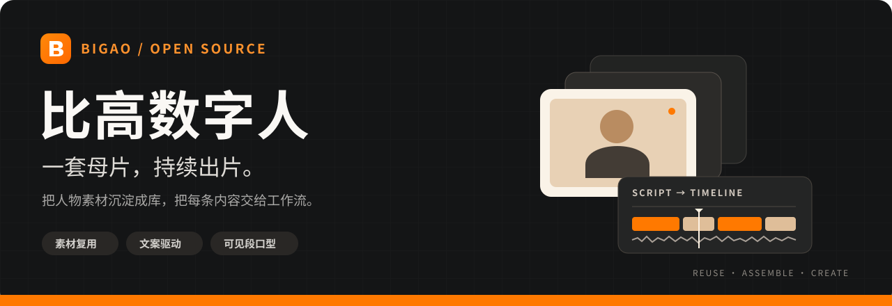
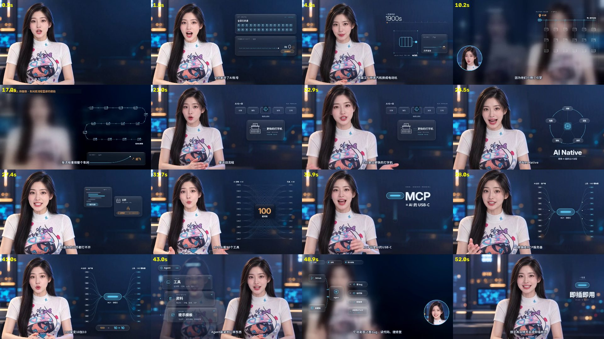

<p align="center">
  
</p>

<p align="center">
  <strong>可复用素材驱动的数字人口播工作流</strong><br>
  准备一次人物母片，围绕新文案持续装配、剪辑与导出。
</p>

<p align="center">
  <a href="docs/QUICKSTART.md"><strong>开始使用</strong></a> ·
  <a href="#效果演示"><strong>看看效果</strong></a> ·
  <a href="https://github.com/bigao123456/bigao-shuziren/releases/latest"><strong>下载源码</strong></a> ·
  <a href="https://github.com/bigao123456/bigao-shuziren/issues"><strong>问题反馈</strong></a>
</p>

<p align="center">
  <a href="https://github.com/bigao123456/bigao-shuziren/actions/workflows/test.yml"></a>
  <a href="LICENSE"></a>
  
  <a href="https://github.com/bigao123456/bigao-shuziren/stargazers"></a>
</p>

## 让人物素材成为可复用的内容资产

比高数字人将人物母片拆成有标签的镜头库，按文案和配音规划时间轴，再完成口型任务编排与 FFmpeg 合成。适合知识讲解、课程内容、产品介绍和长期口播创作。

| 素材反复用 | 文案带着剪 | 按出镜处理 |
| :--- | :--- | :--- |
| 保存人物、景别、动作与表情标签，新内容继续选用。 | 配音锁定时间轴，镜头、字幕与动效跟着内容走。 | 只为人物可见的片段规划口型任务，覆盖画面时跳过。 |

> **使用前了解：** 项目负责素材管理、规划与本地合成。真实人物母片、配音与口型模型需自行准备或接入；内置 `passthrough` 仅作未同步预览，不附带模型权重。

## 效果演示

<p align="center">
  <a href="recipes/demo60/out/demo60_preview_169.mp4"></a>
</p>

<p align="center"><a href="recipes/demo60/out/demo60_preview_169.mp4">播放横版预览</a> · <a href="recipes/demo60/out/916/demo60_preview_916.mp4">播放竖版预览</a> · <a href="DEMO.md">更多演示与复现说明</a></p>

<sub>上图为仓库内置预览的关键帧，展示镜头、字幕、图解和画中画编排；预览不代表已接入真实口型服务。</sub>

## 从母片到成片

| 01 准备素材 | 02 文案规划 | 03 口型与合成 | 04 检查导出 |
| :--- | :--- | :--- | :--- |
| 固定人物形象，切片、打标并复核。 | 准备文案和配音，选择镜头、排出时间轴。 | 接入口型结果，叠加字幕、版式与动效。 | 检查嘴型、接缝和遮挡，导出并记录素材使用。 |

同稿换包装可以复用已确认的配音和口型结果；新稿继续使用母片，重新制作配音与所需口型。实际成本取决于素材准备、所用服务和硬件。

## 快速开始

### 用 Agent 制作

将仓库放入项目的 `.agents/skills/bigao-shuziren/`，让 Agent 加载 [SKILL.md](SKILL.md)，再提供你的人物素材、文案与声音要求：

```text
使用 bigao-shuziren。
优先复用我的人物切片，以确认后的配音锁定时间轴。
制作一条 16:9 口播，只对出镜说话的片段处理口型。
输出成片、字幕和检查结果。
```

### 在本地运行

需要 **Python 3.10+**。以下命令适用于 macOS / Linux；Windows 命令见[中文入门](docs/QUICKSTART.md)。

```bash
git clone https://github.com/bigao123456/bigao-shuziren.git
cd bigao-shuziren
python3 -m venv .venv
source .venv/bin/activate
python -m bigao_shuziren doctor
python -m bigao_shuziren prompts verify
```

基础规划只用 Python 标准库。切片需要 NumPy，渲染需要带所需滤镜的 FFmpeg 和中文字体。

**下一步：** [安装依赖与排错](docs/QUICKSTART.md#1-准备环境) → [运行规划示例](docs/QUICKSTART.md#2-先验证规划不调用模型) → [渲染预览](docs/QUICKSTART.md#3-验证本地合成) → [换成自己的素材](docs/QUICKSTART.md#4-换成自己的素材)。

## 按需要查文档

| 你想做什么 | 从这里开始 |
| :--- | :--- |
| 第一次安装，先跑通一个例子 | [中文入门与常见问题](docs/QUICKSTART.md) |
| 让 Agent 完整执行制作流程 | [技能说明](SKILL.md) |
| 为人物准备母片生成提示词 | [提示词生成包](prompts/GENERATE_PACK.md) |
| 了解标签、数据结构和模块关系 | [素材契约](schema/TAGS.md) · [项目导览](docs/PROJECT_GUIDE.md) · [架构说明](ARCHITECTURE.md) |
| 查看演示和验证结果 | [制作演示](DEMO.md) · [验证记录](docs/VERIFICATION.md) |
| 查看更新或参与改进 | [更新记录](CHANGELOG.md) · [贡献指南](CONTRIBUTING.md) |

<details>
<summary><strong>开发者：目录速览与验证命令</strong></summary>

```text
bigao_shuziren/  品牌命令入口
istream/        素材、规划、口型、合成与检查模块
catalog/        素材标签目录
prompts/        人物与母片提示词
recipes/        演示脚本与配方
docs/           安装、演示与设计文档
tests/          自动回归测试
```

```bash
python -m bigao_shuziren doctor --render
python -m unittest discover -s tests -v
```

兼容原有 `python -m istream` 命令。外部口型引擎适配器主要为模板，接入方式见中文入门。

</details>

---

<p align="center">
  <strong>觉得有用，就留一颗 Star ⭐</strong><br>
  收藏这个项目，也欢迎把它分享给正在做数字人口播的朋友。
</p>

<p align="center">
  <a href="https://github.com/bigao123456">比高 · Bigao</a> ·
  <a href="https://github.com/bigao123456/bigao-shuziren/issues">反馈问题</a> ·
  <a href="LICENSE">MIT License</a> ·
  <a href="NOTICE.md">许可说明</a>
</p>
