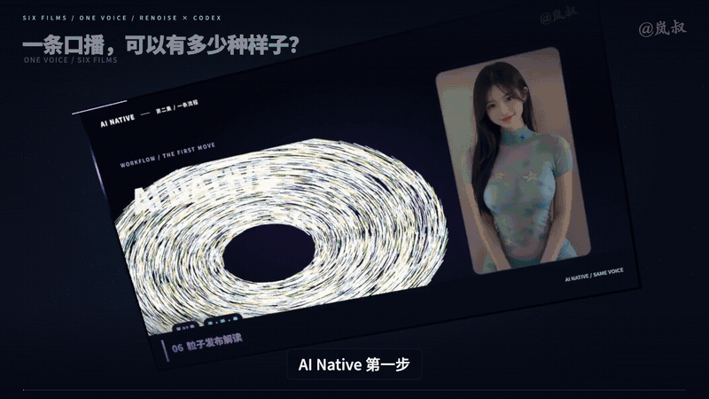

<h1 align="center">bigao-shuziren · 比高数字人</h1>

<p align="center"><strong>一套母片，持续出片。可复用素材驱动的数字人口播工作流。</strong></p>

<p align="center">
  <a href="https://github.com/bigao123456/bigao-shuziren/actions/workflows/test.yml"></a>
  <a href="LICENSE"></a>
  
  <a href="https://github.com/bigao123456/bigao-shuziren/stargazers"></a>
</p>

由比高维护的改进版，基于 [岚叔 / cclank 的 lanshu-infinite-stream-koubo](https://github.com/cclank/lanshu-infinite-stream-koubo)。保留上游作者署名、MIT 许可证和原始制作资料，改进记录见 [CHANGELOG.md](CHANGELOG.md)。

**适合谁：** 希望复用人物母片、按文案装配镜头、制作知识讲解或产品口播的创作者，以及使用 Agent 的开发者。

**开始使用：** [中文入门与排错](docs/QUICKSTART.md) · [完整技能说明](SKILL.md) · [项目结构](docs/PROJECT_GUIDE.md) · [上游演示](DEMO.md)

> 这是素材管理、脚本规划、口型任务编排和 FFmpeg 合成工具。真实人物视频、配音和口型模型需自行准备或接入；仓库不附带 Qwen、Duix 或其他模型权重，也未内置这些服务。`passthrough` 与占位动画用于验证剪辑流程，不会生成真实嘴型。

## 比高版优化

- **运行前可诊断：** `doctor --render --json` 检查 Python、FFmpeg、滤镜、编码器和中文字体；切片依赖可单独检查。
- **失败不冒充成功：** 未接入的口型引擎返回非零退出码，停止后续合成；真实引擎合成前检查结果文件。
- **素材合并更可靠：** 重复母片或镜头编号明确报错，避免悄悄覆盖已有素材。
- **任务更准确：** 可见片段之间的时间空隙单独断开；口型规划复用镜头索引，减少重复构建。
- **参数与输出更友好：** 检查无效缩放、并发数和成本参数，自动创建导出目录，补充 Windows 中文字体路径。
- **便于分享使用：** 统一品牌入口、中文入门、项目导览与贡献说明；兼容原有 `python -m istream` 命令。

## 无限流怎么玩

先生成或拍摄一套人物、服装、光线一致的**母片**，切成带动作、表情、景别标签的镜头库。每次写新稿，就按内容选镜头、配音、处理口型，再用不同版式和动效组合成片。

适合课程、知识讲解、产品介绍等口播内容。素材库可以持续补新，镜头按使用情况轮换。



上图为上游项目提供的成片节选，展示同一套人物切片与音轨的多种包装方式。

## 核心流程

| 阶段 | 做什么 |
| --- | --- |
| **① 准备母片** | 用参考图固定人物，准备近景、中景、温和手势等镜头，保持脸和嘴无遮挡。 |
| **② 切片打标** | 按自然停顿和动作切片，标注表情、视线、手势与入出点，筛掉异常片段。 |
| **③ 文案配音** | 校对配音、对齐台词，以声音锁定时间轴，字幕和镜头跟着声音走。 |
| **④ 选镜与口型** | 按句挑切片，只给人物可见且需要说话的片段做口型；时序调整先完成。 |
| **⑤ 多风格剪辑** | 组合全屏、分屏、圆形小窗、补充画面和动态图文，复用切片完成不同包装。 |
| **⑥ 检查导出** | 核查嘴型、接缝、字幕与遮挡，完整播放后导出横版或竖版，并记录素材使用。 |

## 怎么省成本

- **同稿换风格**：共用母片、配音和已对好的口型，继续剪辑、渲染。
- **新稿换内容**：母片继续用，重新配音，并处理新稿需要的口型。
- **按需处理**：人物被全屏图解或补充画面覆盖的时段，跳过口型任务。

“无限流”强调长期复用与重新组合；母片、模型调用及返修仍按实际使用计费。

## 快速开始

将本目录放进 Agent 的技能目录，例如项目下的 `.agents/skills/bigao-shuziren/`，加载 [`SKILL.md`](SKILL.md)。提供人物参考图或已有切片库、文案和声音要求，即可让 Agent 按流程制作：

```text
使用 bigao-shuziren。
优先复用我的人物切片，以确认后的配音锁定时间轴。
只对需要出镜说话的片段做口型。
制作一条 16:9 口播，人物主讲、圆形小窗与全屏图解交替。
输出成片、字幕和检查结果。
```

本地命令入口：

```bash
git clone https://github.com/bigao123456/bigao-shuziren.git
cd bigao-shuziren
python3 -m venv .venv
source .venv/bin/activate
python -m pip install -r requirements.txt
python -m bigao_shuziren doctor
python -m bigao_shuziren --help
python -m bigao_shuziren prompts verify
```

核心规划模块使用 Python 3.10+；切片需要 NumPy。合成推荐 FFmpeg 7+，须包含 `drawtext`、`subtitles`、`libx264` 和中文字体。macOS 可安装完整版：

```bash
brew install ffmpeg-full
export PATH="$(brew --prefix ffmpeg-full)/bin:$PATH"
python -m bigao_shuziren doctor --render
```

视频、配音与真实口型服务需自行接入；包内口型适配器以模板为主，`passthrough` 用于预览，不会修改嘴型。以上环境检查和示例渲染均不调用生成模型。

```bash
python tools/build_library.py
python -m istream prompts verify
python -m unittest discover -s tests -v
bash tools/run_demo.sh
```

提示词源文件已随仓库提供。没有原始母片时，示例使用带标识的占位动画验证装配流程；原有预览和联系表可在 [`DEMO.md`](DEMO.md) 查看。要复现替身母片示例，将自己的两条原片放到 `source/original-koubo.mp4`、`source/ai-native-original.mp4`，重新切片并复核标签。

## 搭配不同剪辑风格

可以参考下面这些独立 Skill 的分镜、版式和动效，再接上同一套人物切片与音轨：

- **`talking-head-editor` · Renoise**：口播精剪、字幕花字、画中画。 [安装 Renoise](https://renoise.ai/mcp?utm_source=lufzzliz-aini-202610&utm_medium=xcom)
- **[`lanshu-create-ai-presenter-video`](https://github.com/cclank/lanshu-create-ai-presenter-video) · cclank**：纸艺立体书等讲解风格。
- **[`digital-human-koubo`](https://github.com/andyhuo520/digital-human-koubo) · andyhuo520**：发布解读、粒子文字、文档聚焦。

## 详细文档

| 文档 | 内容 |
| --- | --- |
| [`docs/QUICKSTART.md`](docs/QUICKSTART.md) | 从下载到示例规划、渲染与常见问题 |
| [`docs/PROJECT_GUIDE.md`](docs/PROJECT_GUIDE.md) | 模块结构、输入输出与兼容说明 |
| [`SKILL.md`](SKILL.md) | 完整流程、命令、剪辑规则与口型处理 |
| [`prompts/GENERATE_PACK.md`](prompts/GENERATE_PACK.md) | 参考图与母片生成提示词 |
| [`schema/TAGS.md`](schema/TAGS.md) | 切片标签与素材契约 |
| [`DEMO.md`](DEMO.md) | 装配、改片与多画幅示例 |
| [`ARCHITECTURE.md`](ARCHITECTURE.md) | 架构、接口与适配范围 |

## 许可证

项目代码采用 [MIT License](LICENSE)。第三方依赖、外部服务及人物、图片、音视频素材遵循各自的授权和使用条款。

---

**比高版维护：** [bigao123456](https://github.com/bigao123456)。原项目由 **岚叔（Lanshu / cclank）** 整理与维护，[原作者 X](https://x.com/LufzzLiz)。详见 [NOTICE.md](NOTICE.md)。

如果这个项目对你有帮助，欢迎点击仓库右上角 **Star ⭐** 收藏，也欢迎提交 Issue 或改进建议。分享地址：https://github.com/bigao123456/bigao-shuziren
